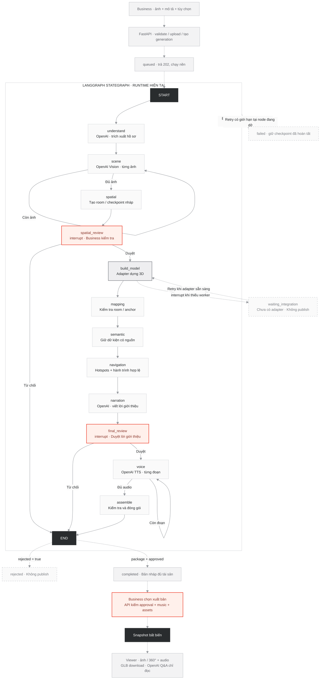

# Estagent — luồng LangGraph tạo tour cho Business

Ngày đối chiếu: 2026-10-31. Source: `server/creator/graph.py`, `service.py`, `api.py`,
`provider.py`, `store.py` và `package.py` trên branch `web/creator-studio-integrated`.

**Kết luận: diagram gốc khớp mục tiêu sản phẩm, chưa khớp runtime hiện tại.**
Hai nhóm tác vụ song song, ước lượng floorplan, tự bỏ qua spatial review, vòng
Edit & Regenerate, dual-view 3D hoàn chỉnh và MP4 là kiến trúc đích. Code hiện tại
chạy tuần tự, luôn duyệt spatial, duyệt lời trước TTS và publish bằng API riêng.
Blender/MCP chưa nối; thiếu adapter sẽ tạm dừng thật, không tạo mô hình giả.

## 1. Hai bản diagram và nguồn đối chiếu

- `Estagent_Business_LangGraph_Flow.reference.mmd`: file user cung cấp, giữ nguyên
  để đối chiếu kiến trúc đích.
- `Estagent_Business_LangGraph_Flow.mmd`: luồng nghiệp vụ phản ánh code; khối
  StateGraph và các cạnh bên trong lấy trực tiếp từ khai báo graph.
- `Estagent_Business_LangGraph_StateGraph.mmd`: xuất bằng formatter
  `Graph.draw_mermaid()` từ `StateGraph.builder.edges` và `branches.ends`.
  Chỉ có node/cạnh LangGraph, không trộn API,
  trạng thái hàng đợi, publish hoặc Viewer thành node graph.

Trong diagram nghiệp vụ: đường liền trong khối LG là cạnh graph; đường nét đứt
ngoài khối diễn giải lifecycle/API. `interrupt()` lưu rồi dừng **ở node hiện tại**,
không phải một tác vụ chạy nền mới. Diagram native dùng nét đứt cho cạnh điều kiện
theo cách xuất mặc định của LangGraph. Hai cách biểu diễn không đổi execution.

Các nhánh điều kiện được khai `path_map` rõ ràng. Điều này giúp exporter không
vẽ nhầm rằng mỗi router có thể đi đến mọi node; điều kiện runtime giữ nguyên.
Khi kiểm bộ dependency đã pin, `compiled.get_graph()` vẽ mất hai nhánh reject
tới END và thêm cạnh voice → END. Helper đối chiếu khai báo StateGraph nguyên bản,
không coi lỗi trình bày đó là execution semantics; JSON evidence ghi lại cả hai.

<!-- runtime-graph:start -->

<!-- runtime-graph:end -->

## 2. Diagram gốc khác code ở đâu?

| Diagram tham khảo | Runtime hiện tại | Đánh giá |
| --- | --- | --- |
| Input Processing là node graph | API xác thực/lưu input, tạo generation trước khi invoke graph; `understand` trích xuất brief | Cần tách API khỏi graph |
| Vision và Layout Estimation chạy song song | `scene` xử lý từng ảnh, checkpoint sau từng lần; chưa có layout estimator/floorplan parser | Chưa triển khai fan-out/fan-in |
| Spatial Graph có floors, geometry, camera anchors đầy đủ | `spatial` tạo một room/checkpoint nháp cho mỗi ảnh; connections rỗng, `estimated=true` | Chưa đo kích thước, cluster phòng hoặc suy topology |
| Reliable layout được bỏ qua Spatial Review | Mọi generation đều vào `spatial_review` và `interrupt()` | Không có reliability bypass |
| Blender MCP đã dựng nhà | `creator_worker` là adapter được inject; default `None` | Chờ nối worker/MCP như phạm vi đã giao |
| Checkpoint Registration tự ước lượng pose | `mapping` kiểm checkpoint IDs và room IDs của anchors do worker trả | Chưa có pose estimation |
| Semantic enrichment là một agent đầy đủ | `semantic` giữ facts có provenance `verified`/`observed` | Chưa có enrichment từ nguồn bên ngoài |
| Navigation và Narration/TTS chạy song song | `navigation → narration → final_review → voice` | Tuần tự; script tách TTS |
| Duyệt sau Package + QA + audio | `final_review` duyệt script trước TTS; `assemble` kiểm dữ liệu sau TTS; Business vẫn chủ động chọn publish | Không phải duyệt final audio bằng một graph interrupt khác |
| Publish / Export là node graph | Publish là API sau khi graph END và draft completed | Không có graph node publish hoặc MP4 export |
| Edit quay lại đúng nhánh để tái sinh | Review sửa label/yaw/links hoặc script ngay tại interrupt; reject kết thúc | Chưa có selective regeneration/version editor |
| Dual-view 3D ↔ 360° hoàn chỉnh | Viewer có ảnh/360°, liên kết, audio/Q&A và tải GLB | Chưa có renderer GLB/orbit/transition 3D |

Không sửa code thành “đã có” những phần kiến trúc đích chỉ để diagram trông khớp.
Các phần chưa làm được ghi rõ; diagram runtime là bản dùng để kiểm implementation.

## 3. Từ form Business đến execution thread

1. Business mở `/business/create`, nhập tên/mô tả, thêm 1–12 ảnh và tùy chọn
   floorplan, nhạc WAV, locale/voice. Key không xuất hiện trong trình duyệt.
2. `POST /api/studio/projects` tạo project theo cookie sở hữu; các request upload
   lưu asset riêng, kiểm bằng Pillow và loại trùng SHA-256. Ảnh chỉ được xoay 360°
   khi Business xác nhận equirectangular và kích thước nhất quán; tỷ lệ 2:1 tự nó
   không đủ làm bằng chứng. Ảnh thường vẫn được xem 2D.
3. `POST /api/studio/projects/{id}/generations` cần provider đã cấu hình và ảnh
   hợp lệ; trả `{id: generation_id}`, HTTP 202. Input bị khóa từ đây.
4. Service ghi `queued`, đưa vào execution worker. Một generation thực thi cùng
   lúc; tối đa 8 generation đang queued/running. Đây là ThreadPoolExecutor trong
   một API process, chưa phải Redis.
5. Khi worker nhận việc, status đổi `running`; gọi `graph.invoke` với
   `configurable.thread_id = generation_id` và recursion limit 100.

`project_id`, `generation_id` và cookie có vai trò khác nhau: project chứa input;
generation là execution thread; cookie xác định phiên được đọc/ghi. MVP không auth
không đồng nghĩa project riêng có thể được truy cập chỉ bằng một ID bất kỳ.

## 4. Các node thực sự đang chạy

| Node | Việc thực hiện | State được ghi / nhánh tiếp theo |
| --- | --- | --- |
| `understand` | OpenAI Responses Structured Outputs đọc mô tả; validate `Brief` | `brief` → `scene` |
| `scene` | OpenAI Vision đọc một ảnh chưa xử lý; validate observation, nguồn và uncertainty | Append `observations`; còn ảnh → chính nó, đủ ảnh → `spatial` |
| `spatial` | Tạo `cp01…`, `r01…`, label/summary/facts, projection và yaw mặc định; chưa tính geometry | `rooms`, `connections=[]`, `estimated=true` → `spatial_review` |
| `spatial_review` | `interrupt(kind=spatial)`; Business xác nhận tên khu, yaw và các đường nối có thật | Merge rooms/links; approve → `build_model`, reject → END |
| `build_model` | Gọi adapter `build(project, rooms, connections, assets)`; lưu GLB đã kiểm container/scene/mesh và anchors hữu hạn | `model` → `mapping`; thiếu worker → integration interrupt ngay tại node |
| `mapping` | Mọi checkpoint phải có anchor, không thiếu/thừa ID; anchor.room_id phải khớp room | Gắn `anchor` vào `rooms` → `semantic` |
| `semantic` | Giữ facts `verified`/`observed`, không tự nâng suy luận thành dữ kiện xác minh | `rooms` → `navigation` |
| `navigation` | Từ links đã duyệt, tạo hotspots có hướng và target_yaw; DFS tạo itinerary đi theo đường nối, có thể quay lại khu cũ | `navigation_config`, `itinerary` → `narration` |
| `narration` | OpenAI viết introduction và đúng một segment mỗi checkpoint; kiểm IDs và nguồn | `script` → `final_review` |
| `final_review` | `interrupt(kind=final)`; Business kiểm/sửa lời từng khu; validate đủ segment/nguồn | `script`, `approved`, `rejected`; approve → `voice`, reject → END |
| `voice` | OpenAI TTS cho một đoạn: introduction trước, rồi từng segment; kiểm WAV và duration thực | Append `audio`; còn đoạn → chính nó, đủ → `assemble` |
| `assemble` | Validate Geometry, Room, Narration và audio phủ đủ introduction/checkpoints; gom asset refs | `package` → END |

`verified` ở đây là Business cung cấp/xác nhận, không phải kiểm định độc lập về
pháp lý hoặc số đo. Chỉ có source hợp lệ cũng không tự chứng minh mọi câu LLM
viết là đúng; Business review vẫn là bước cần thiết.

## 5. Interrupt, resume và lỗi

### Spatial / final review

Service đọc interrupts trong graph snapshot và phát `needs_review`. API
`POST /api/studio/generations/{id}/review` chỉ nhận đúng kind đang chờ và payload
hợp lệ, sau đó enqueue `Command(resume=review)`. Node bị interrupt chạy lại từ
đầu; `interrupt()` nhận giá trị resume rồi mới đi tiếp. Các call AI đã hoàn tất
nằm ở node trước đó nên không bị chạy lại chỉ vì Business duyệt.

Spatial approve cần đủ checkpoint đúng một lần; yaw/pitch nằm trong miền hợp lệ.
Links không trùng/self-loop, có cả hai chiều và mọi checkpoint phải reachable.
Final edit cần đúng một segment mỗi checkpoint và sources thuộc project.
`reject` đặt cờ rejected, đi END và không chạy downstream hoặc publish.

### Chưa có Blender / geometry worker

`build_model` dùng `interrupt(kind=integration)` và service ghi
`waiting_integration`. Trình duyệt không thể dùng final approval để vượt qua.
Khi backend đã inject adapter và restart, retry của generation cũ dùng
`Command(resume=True)`; code mới thực hiện build thay vì dừng ở integration gate.
Nó không tự chạy tiếp chỉ vì người dùng reload trang.

### Provider/worker lỗi hoặc process dừng

Exception được service chuyển thành `failed`; UI nhận thông báo đã làm sạch,
không nhận raw upstream body hoặc chain-of-thought. Khi restart, bản ghi
queued/running trở thành failed để người dùng kiểm tra trước khi retry. Interrupt
đang chờ người dùng vẫn được giữ. Retry là chủ động: lần đầu và tối đa 2 retry,
tổng cộng 3 attempts; duyệt interrupt không tăng counter. Service tiếp tục
dùng cùng thread với checkpoint hiện có, không bắt đầu toàn bộ project từ đầu.

Checkpoint giữ bước đã hoàn tất. Nếu process chết khi call còn đang bay hoặc
trước khi checkpoint được commit, không có cam kết exactly-once. Adapter ngoài
phải dùng generation_id làm khóa idempotency; SDK OpenAI không tự retry.

## 6. State, storage và Activity Stream

State gồm: `project`, `assets`, `brief`, `observations`, `rooms`, `connections`,
`model`, `navigation_config`, `itinerary`, `script`, `audio`, `approved`,
`rejected`, `package`. Không nhét GLB hoặc WAV lớn vào state; state giữ asset IDs.

- `graph.sqlite`: SQLite checkpointer theo generation thread.
- `creator.sqlite`: project, binary assets, generation status, events, request
  deduplication, published snapshots và Viewer question ledger.
- `STUDIO_DATA_DIR`: thư mục riêng cạnh assistant DB, Compose đặt `/data/studio`.
- Mỗi node phát running/completed; service phát trạng thái chờ/lỗi/hoàn tất.
  SSE replay theo event_id / Last-Event-ID; reload lấy snapshot đã lưu.
- UI chỉ đếm các milestone thật, không dự đoán phần trăm theo thời gian.
  Mỗi call ảnh/TTS lặp xong được checkpoint riêng; không phải parallel batch.

`completed` nghĩa bản nháp đã đủ package, chưa có nghĩa đã xuất bản.
`confirmed` của assistant intake cũ cũng không phải approval của Studio.

## 7. Publish và Customer Q&A nằm ngoài StateGraph

Sau END thành công, Business có thể xem trước rồi chọn
`POST /api/studio/generations/{id}/publish`. Service yêu cầu status completed,
package approved, nhạc có credit/quyền sử dụng và mọi asset được tham chiếu còn
tồn tại. PublishedTour schema kiểm lại dữ liệu, sau đó lưu snapshot bất biến.
Cùng generation đã publish trả về cùng public ID.

Customer mở `studio-tour.html?id=...`; API chỉ phục vụ asset có trong snapshot.
Q&A dùng cùng `OPENAI_API_KEY` và `OPENAI_MODEL_TEXT`, chỉ đọc snapshot đã duyệt.
Output là text và optional navigate_to đã kiểm checkpoint ID; không có tool
ghi metadata hoặc publish. Hỏi đáp tạm dừng narration, không tự phát tiếp.

Nhạc hiện là tùy chọn khi lưu nháp nhưng bắt buộc khi publish. Do input khóa sau
khi bắt đầu generation, hiện chưa có đường thêm nhạc muộn vào generation cũ;
đây là khoảng trống sản phẩm cần giải quyết ở vòng chỉnh sửa/regeneration sau.

## 8. Phần còn phải nối để đạt diagram kiến trúc đích

- Floorplan parsing/layout estimation và spatial graph có geometry/floors được
  đo hoặc xác minh; clustering nhiều ảnh cùng phòng, uncertainty có nguồn.
- Adapter Blender/MCP có job idempotency, geometry/bounds QA, materials,
  room-to-mesh mapping và preview renders. Hiện chỉ có seam + validation container.
- Renderer GLB, room picking và chuyển 3D ↔ panorama. Hiện chỉ tải GLB xuống.
- Partial regeneration, revision history/editor sau reject hoặc publish, upload
  nhạc muộn; MP4 là worker riêng, chưa phải node thực hiện trong graph.
- Chỉ thêm song song nếu task độc lập, có reducer/merge state rõ ràng và budget
  thực; không vẽ fan-out/fan-in như thể đã chạy khi code vẫn tuần tự.

OpenAI live/model access/quota/voice và geometry thật chưa được chứng minh bằng
fixture. Text/vision/script dùng Responses Structured Outputs, TTS dùng audio
speech API; key chỉ ở backend. Giữ model cấu hình, timeout 30s, không fallback
provider, SDK retries=0; bản hiện tại giới hạn 14 structured calls và 13 TTS
segments mỗi generation tối đa, chưa tính call đang dở được retry chủ động.

## 9. Xuất lại và kiểm diagram

```bash
uv run --python 3.13 --with-requirements server/assistant/requirements.txt \
  python scripts/export_studio_graph.py --downloads-dir "C:/Users/ADMIN/Downloads"
```

Helper chỉ compile/đọc khai báo graph, không invoke model/worker. Nó xuất diagram native,
sinh cạnh graph của bản nghiệp vụ từ cùng IR và cập nhật block Mermaid trong
Markdown này. Bản gốc ở Downloads được giữ dưới tên `.reference.mmd`.
Mermaid được parse/render offline để kiểm cú pháp theo
[flowchart syntax chính thức](https://mermaid.js.org/syntax/flowchart.html).

Declaration: tài liệu/UI được cập nhật với Codex từ source trong repo và diagram
user cung cấp. Không thêm runtime dependency, không gọi OpenAI/Blender có phí.
H0 chưa xác minh; không tuyên bố đây là build trong thời gian thi.
