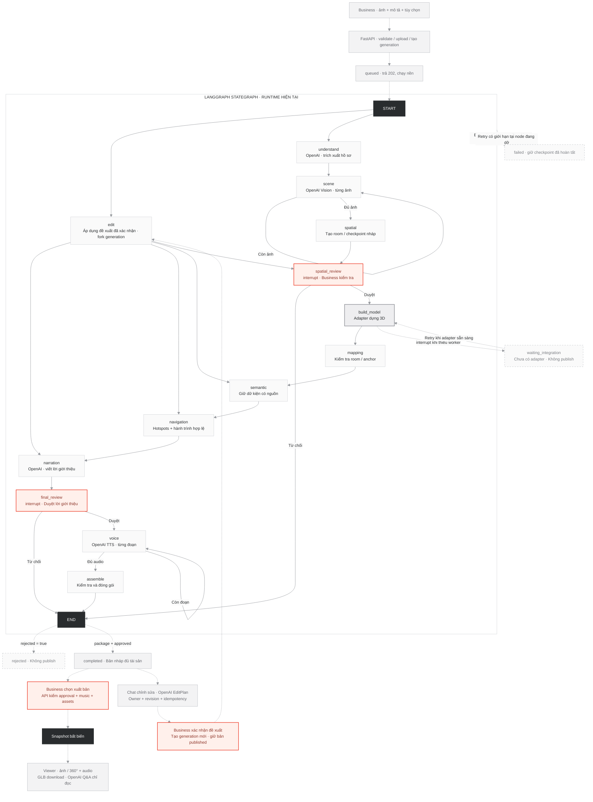

# Estagent — Business LangGraph runtime

Ngày đối chiếu: 2026-10-31. Authority: `server/creator/graph.py`, `service.py`,
`runtime.py`, `edits.py`, `worker.py`, `store.py`, `provider.py` và `api.py`.
Phạm vi Thái đã chốt: hoàn thiện khung production và điểm nối, chưa làm model
tái dựng, Blender MCP hoặc MP4. Đây là code runtime, không chỉ thay tên diagram.

## Diagram và source authority

`Flow.mmd` bên cạnh là business diagram; cạnh liền trong khối LG lấy từ khai báo
StateGraph. Cạnh nét đứt ngoài khối giải thích API/lifecycle, không phải node chạy.
`StateGraph.mmd` là Mermaid native, xuất bằng Graph.draw_mermaid từ
`compiled.builder.edges + branches.ends`. Bản gốc user cung cấp giữ nguyên trong
`Flow.reference.mmd` để đối chiếu mục tiêu đầy đủ.

LangGraph đã pin có lỗi visualizer `compiled.get_graph()` làm mất/ghép sai một số
cạnh END; exporter đọc khai báo graph gốc, không sửa diagram bằng cạnh tự đoán.
Mọi conditional router khai path_map. Export không invoke graph/model.

<!-- runtime-graph:start -->

<!-- runtime-graph:end -->

## Luồng tạo mới

1. Creator tải 1–12 ảnh, mô tả, tùy chọn floorplan và music có nguồn/quyền dùng.
   Backend kiểm ảnh/WAV, owner/cookie, Origin, dung lượng và request dedup.
   Ảnh chỉ được coi equirectangular khi user xác nhận và tỷ lệ phù hợp.
2. Start ghi generation và SQLite job trong cùng transaction; HTTP trả 202.
   Một dispatcher thực thi graph; UI đọc progress/SSE có cursor bền vững.
3. `understand` trích brief từ mô tả bằng OpenAI. `scene` xử lý từng ảnh, checkpoint
   sau mỗi ảnh, không tự suy ra phòng nối nhau hay số đo hình học.
4. `spatial` tạo checkpoint/room nháp; `spatial_review` interrupt bắt buộc.
   Business xác nhận label/yaw và đường nối hai chiều; backend kiểm connectivity.
   Reject kết thúc, không TTS/publish.
5. `build_model` gọi adapter geometry. Chưa có adapter thì waiting_integration;
   có HTTP adapter thì submit idempotent/poll job thật. Không dựng GLB giả.
6. `mapping` kiểm checkpoint/room/anchor; `semantic` giữ provenance phù hợp;
   `navigation` tạo hotspot/hành trình hợp lệ; `narration` soạn script bằng OpenAI.
7. `final_review` interrupt cho Business sửa/duyệt script trước TTS. Reject kết
   thúc; approve mới đi `voice`, một đoạn/checkpoint với WAV duration đo thật.
8. `assemble` kiểm model, room, audio coverage và package. Completed vẫn là draft.
9. Publish API riêng kiểm approved/music/assets rồi tạo snapshot bất biến.
   Viewer Q&A chỉ đọc snapshot; không chỉnh metadata hoặc tự publish.

## Chat chỉnh sửa và selective regeneration

Chat Studio đã nối vào vòng LangGraph sau khi có room/checkpoint nháp, kể cả
đang chờ worker. Nếu chưa có geometry, mọi edit quay lại spatial_review rồi
build_model; không thể dùng edit để nhảy qua worker hoặc publish sớm.

1. `POST /generations/{id}/edits`: owner + revision + request_id + text tự do.
   OpenAI trả EditPlan có schema; backend kiểm lại ID, source, permutation,
   góc hữu hạn, topology hai chiều. Input/model không được chọn tool hoặc URL.
2. Proposal lưu SQLite, UI hiển thị reply và diff; reload vẫn đọc lại được.
   Yêu cầu ngoài phạm vi hoặc chưa rõ chỉ có reply, không có nút thực thi.
3. Business chọn **Áp dụng · Tạo bản mới**. Backend kiểm revision lần nữa, consume
   proposal, tạo child generation có parent_id và queue job trong transaction.
4. Child bắt đầu `edit` và backend chọn đường chạy theo trường thay đổi:

| Thay đổi | Route sau edit | Invalidation |
|---|---|---|
| Yaw/connections | spatial_review | Bỏ geometry/anchors, bắt buộc duyệt bố cục |
| Label/summary | semantic | Giữ geometry/vision, dựng lại navigation/script |
| Order/start | navigation | Giữ geometry/script, tính lại hành trình |
| Script/introduction | narration | Dùng nội dung xác nhận, không gọi LLM viết lại |

5. Child luôn quay lại final_review trước khi hoàn tất. Audio chỉ tái dùng khi
   checkpoint/text khớp script cũ; text đổi mới gọi TTS. Không chạy lại brief/
   vision cho edit thuộc các route trên. Published parent giữ nguyên.

Legacy Creator `/creator.html` và `/api/tours/*` vẫn giữ contract cũ; Studio là
luồng generation có review/worker/refinement mới. Viewer trong cả hai luồng không
có quyền ghi nguồn. Không claim legacy manifest đã biến thành reconstruction.

## Durability và production boundary

Một API process/một dispatcher/một volume local; OS file lock chặn process thứ hai.
SQLite outbox chứa payload đã commit; queued tự chạy lại sau restart. Running bị
crash chuyển failed và cần retry chủ động, tránh tự lặp paid operation không rõ
kết quả. Shutdown hoàn tất node đang chạy, lưu checkpoint rồi queue continuation.
Không có exactly-once OpenAI khi crash giữa upstream success và local checkpoint.

Geometry HTTP v1 lưu remote job ID và stable idempotency key; pending requeue sau
5s, tối đa 180 polls/30 phút. Worker thật phải thực hiện reconstruction/registration
và geometry QA; backend kiểm container/anchor, chưa chứng minh số đo thực tế.
Không có adapter thì không publish. Không có replica/Redis/PostgreSQL được ngầm giả định.

OpenAI dùng chung key backend cho text/vision/TTS/Q&A; không fallback provider.
SDK retries=0, timeout 30s; generation retry tối đa 3, queue tối đa 8, tối đa 20
versions/project và 20 proposals/version. Shared admission guards bao gồm edit/apply.
Các cap này không phải giới hạn USD. Health kiểm dispatcher/SQLite, không gọi model.

## Đối chiếu với kiến trúc đích

| Hạng mục | Runtime hiện tại |
|---|---|
| Input, Vision, spatial graph/checkpoint | Có; không bịa geometry |
| Human spatial/final approval | Có interrupt, reject → END |
| Chat Edit & Regenerate | Có proposal/confirmation/fork và router thật |
| Durable queue, resume, revision, idempotency | Có trên một host |
| Blender/MCP seam | Có HTTP async adapter; chưa nối worker thật |
| Semantic, navigation, narration, TTS, immutable publish | Có, QA fixture |
| Vision/layout hoặc nav/narration song song | Chưa triển khai; giữ tuần tự |
| Floorplan estimation/reliability auto-bypass | Chưa có model; luôn duyệt spatial |
| 3D renderer dual-view, geometry accuracy QA, MP4 | Chưa triển khai |

Diagram hiện tại khớp **khung runtime đã chốt**, không đồng nghĩa kiến trúc đích
đã có model/Blender/MP4 hoàn chỉnh. QA dùng HTTP/LangGraph/SQLite/SDK/browser thật
với dữ liệu synthetic; không paid OpenAI hoặc live worker. Hướng dẫn vận hành,
protocol và giới hạn: [STUDIO-RUNTIME.md](../STUDIO-RUNTIME.md).
SSH/deploy/backup/rollback: [STUDIO-DEPLOY.md](../STUDIO-DEPLOY.md).
