# Một sản phẩm, hai vai trò: tạo tour và xem nhà

Thiết kế ngày 2026-10-31, source đối chiếu `6c50572344930f338b83517c908b88edf05dd8f1`.
Đây là thiết kế để nối các phần đang rời nhau; không phải tuyên bố toàn bộ luồng đã deploy.
Inventory tại VM và public API đã đọc thực tế; không sửa/publish dữ liệu trong task này.

**Creator/người đăng nhà** nhập ảnh và mô tả một lần, kiểm tra nội dung/bố cục, duyệt
tour, chia sẻ cho khách và xuất video giới thiệu. **Viewer/người tìm thuê** khám phá
nhà, nghe giới thiệu, hỏi về khu đang xem và quyết định có cần đi xem trực tiếp.
Landing chỉ có hai entry “Tạo tour” và “Xem tour”. AI Studio là bước bên trong Creator;
không có vai trò hay CTA sản phẩm thứ ba. Dòng “Mở demo” là lựa chọn dữ liệu trong
hai entry này, không mở thêm một sản phẩm độc lập.

## 1. Dữ liệu thật đang có và phần nào dùng được

Evidence metadata an toàn: [demo-inventory.json](evidence/demo-inventory.json).
Không có ảnh, video, DB, credential hoặc dữ liệu người dùng riêng trong evidence này.

| Bộ dữ liệu | Quan sát trực tiếp | Sử dụng trong luồng | Giới hạn phải giữ |
|---|---|---|---|
| Public demo Hackathon | GET thư viện có đúng một tour `f9c9100bf6effa0f141594dd972bed6d`, 4 scene cylindrical, audio unavailable | Golden path Viewer hiện tại; Creator tạo bản sao riêng sau khi có chức năng copy | Ảnh sự kiện, không phải căn nhà thuê; góc phủ 240° provisional, không full 360/3D; canonical snapshot giữ nguyên |
| `/opt/estagent/zind-house-000-threejs-handoff.zip` | ZIP hoàn chỉnh 310,757,708 bytes, 239 file; đọc được README/data contract/manifest | Demo nhà có panorama, floorplan annotation, cached model và cached view video | Có sẵn trên VM không có nghĩa đã import vào Estagent hoặc được phép redistribute/public export |
| ZInD input | 32 JPEG gốc, toàn bộ header 2048×1024; tổng 15,293,072 bytes; SHA-256 khớp checkpoints metadata | Ảnh mẫu cho upload/scene grouping và panorama source | 15 không gian annotated; 32 capture không đồng nghĩa 32 phòng; tỷ lệ 2:1 cần kết hợp provenance, không tự suy panorama cho ảnh khác |
| ZInD geometry | `viewer/public/house/dollhouse-studio.glb`, 9,682,280 bytes; header glTF2/length đúng, 1 scene, 876 meshes, 12 images | Cached authored model để mở tổng thể và click capture sau khi có adapter/renderer | Shell theo annotation; fixture kích thước/vị trí approximate, materials authored; không phải app vừa reconstruct từ ảnh |
| ZInD floorplan/checkpoints | `metadata/floorplan.json`: 15 rooms; checkpoints: 32 captures; 16 marker được chọn | Group room/capture, nguồn bố cục và camera anchor | `neighbors` chỉ cùng room; thứ tự/cự ly không chứng minh nối giữa phòng; SVG derived từ annotation, không phải raster survey mới |
| ZInD cached MP4 | 13 file duy nhất dưới `viewer/public/house/renders/`; mọi SHA khớp manifest; MVHD từng file 3.917s | Tùy chọn preview cached view trong 6 không gian có nhiều capture | 4096×2048 theo manifest, upsampled source; ping-pong 94 frames/24fps; không native 4K capture, không video giới thiệu đã phối nhạc/lời |
| ZInD audio | ZIP không có WAV/MP3/M4A/OGG | Cần bản thu có quyền hoặc TTS đã được duyệt riêng | Không dùng test tone/silence để giả lời giới thiệu/nhạc thật |
| `seoul-floorplan-and-model.zip.filepart` | 230,592,384 bytes, không được `zipfile.is_zipfile` nhận là ZIP hoàn chỉnh | Không đưa vào demo/catalog | Chờ chuyển xong và kiểm manifest/checksum; tên file không chứng minh nội dung |

ZInD runtime có `viewer/dist` và `viewer/public` trùng asset. Chỉ một cây
`viewer/public/house` đã là **153,718,691 bytes**, chưa phải dung lượng tối ưu cho app.
Không copy cả ZIP, duplicate dist/public, Blender source và model cũ vào bucket runtime.
Chọn source panoramas + model hiện hành + manifest cần thiết; 13 video chỉ thêm khi
người dùng cần cached views và còn quota. Tính cả ảnh/thumbnail chuẩn hóa, audio,
output video và phần đang dùng trước khi xét quota bucket 512 MiB.

Gói ZInD tối thiểu đề xuất: 32 source JPEG **15,293,072 bytes** + current GLB
**9,682,280 bytes** = **24,975,352 bytes**, cộng manifest/mapping/provenance cần thiết
và thumbnail chuẩn hóa. 13 cached clips là lớp tùy chọn tải khi cần; không lấy toàn
cây153MB hoặc cảZIP310MB làm payload upload mặc định. Dung lượng nhỏ hơn không tự
giải quyết giới hạn12images/12rooms của Studio; vẫn cần importer/grouping contract.

ZIP có panorama equirectangular theo data contract, GLB authored và PanSplat cache.
Không gộp ba provenance này thành một nhãn “AI dựng nhà 3D”. Header/hash được kiểm
trong task này; chưa chạy browser viewer hoặc decode toàn video, chưa chạy script trong ZIP.

Nguồn ghi trong bundle: [ZInD sample house 000](https://github.com/zillow/zind/tree/main/sample_tour/000),
[ZInD terms](https://bridgedataoutput.com/zillowterms),
[PanSplat source](https://github.com/chengzhag/PanSplat), commit/hash model trong manifest.
Terms page không trả readable text trong lần kiểm; **quyền public demo/redistribution/video
export chưa được xác nhận**. Trước public import phải xác nhận điều khoản và attribution
cho dataset, cached renders và authored model; MIT của Three.js không cấp quyền cho ảnh nhà.

## 2. Một luồng Creator thống nhất

Giữ entry `/creator.html` để tương thích hiện tại. Các trang `/business/create`,
`studio.html` và `studio-tour.html` hiện có là implementation debt cần nối qua adapter;
không bắt người dùng chọn “Creator thường” hay “AI Studio”. UI có thể chạy từng bước
trong một workspace, luôn giữ project đang mở và nguồn dữ liệu rõ ràng.

```mermaid
flowchart LR
  C[Creator: chat + ảnh hoặc bản sao demo] --> I[Chuẩn hóa input và khai nguồn]
  I --> A[Phân tích khi có AI; nhập tay hoặc đọc annotation khi có cache]
  A --> R[Duyệt facts, nhóm phòng và nguồn bố cục]
  R --> M{Artifact có thật?}
  M -->|Ảnh/panorama| P[Preview điểm xem đúng phép chiếu]
  M -->|Cached model đã xác minh| P
  M -->|Worker dựng model| W[Chờ job thật hoặc báo thiếu worker]
  W --> P
  P --> N[Lời giới thiệu + nhạc có quyền]
  N --> V[Duyệt đúng revision và nghe/xem thử]
  V --> S[Publish snapshot bất biến]
  S --> U[Viewer: khám phá + audio + Q&A]
  S --> E[Creator: khung hình video 9:16 hoặc 16:9]
  E --> D[Render thật → preview → tải xuống]
```

### Bước/screen/action/state và artifact

| Bước hiển thị | Hành động cụ thể | State/artifact cần lưu | API có thật và phần cần nối |
|---|---|---|---|
| 1. “Bạn muốn giới thiệu nơi nào?” | Nhập mô tả và thả nhiều ảnh cùng lượt chat; hoặc “Dùng dữ liệu mẫu” | Initial message, attachment refs, tên/locale/nguồn; chưa có model | Tour upload + create draft có thật. Studio project/assets có thật nhưng tách input; cần một intake adapter giữ cùng conversation/project |
| 2. Kiểm tra ảnh | Hiển thị thumbnail, format, ảnh trùng, ảnh lỗi; chọn ảnh thường/panorama có căn cứ | Normalized assets, projection evidence, coverage source, provenance | `/api/tours/assets` JPEG/PNG/WebP ≤12MiB; HEIC415. Studio ≤20MiB/file, ≤80MiB/project. Không tự nâng limit để nhận ZIP |
| 3. Hiểu nội dung | AI phân tích khi configured và được phép; keyless cho nhập tay/đọc annotated demo | Facts phân loại supplied/observed/inferred/unknown, room groups, missing data | Legacy chat chỉ text, không nhìn ảnh. Studio vision graph có source nhưng live chưa nghiệm thu; keyless không chạy model. Cached annotation import là chức năng cần thêm |
| 4. Duyệt phòng và bố cục | Creator gộp nhiều góc cùng phòng, sửa nhãn; xác nhận nối giữa phòng nếu có nguồn | Room↔capture mapping, confirmed links, original evidence IDs; review revision | Studio hiện 1 ảnh→1 checkpoint, tối đa12; không có clustering đầy đủ. ZInD15rooms/32captures cần schema/import mapping, không nhét sai thành12phòng |
| 5. Xem trước không gian | Preview photo/cylindrical/equirectangular đúng nguồn; chọn tổng thể khi có model | Projection + pose/coverage; model source cached/worker; geometry validation | Legacy Viewer cylindrical/photo có thật; Studio equirectangular có source. GLB renderer chưa tích hợp sản phẩm. Worker absent → `waiting_integration`, không tạo geometry giả |
| 6. Lời và nhạc | Creator soạn/duyệt lời từng khu; upload WAV và source/rights; nếu có TTS, duyệt script trước khi gọi | Transcript/source locale, immutable track refs, measured duration, music rights | Legacy audio WAV upload/attach có thật, music optional. Studio TTS có source nhưng thiếu live key/worker; publish Studio hiện bắt buộc music/audio/model. Cần thống nhất policy không hạ validation âm thầm |
| 7. Duyệt cuối | Xem tour ở kích thước mobile, nghe lời/ducking, kiểm thông tin chưa biết; chủ động “Duyệt bản này” | Saved revision + review revision, QA results; nghe audio đã tạo trước publish | Legacy review/publish exact revision có thật. Studio `final_review` hiện duyệt script trước TTS; cần bổ sung UI post-assembly audio preview, không đổi thứ tự thực tế trong diagram |
| 8. Chia sẻ tour | Creator bấm Publish, nhận link; sửa tiếp tạo bản mới, không thay link cũ | Published immutable snapshot, asset membership, credits | Legacy `/api/tours/drafts/{id}/publish`; Studio generation publish có thật riêng. Cần Viewer facade hiểu cả source kinds thay vì buộc người dùng chọn hai hệ thống |
| 9. Xuất video | Chọn9:16/16:9, chọn điểm xem/thời lượng/framing và audio, preview rồi Render | Frozen source revision, export settings/job/artifact | Lane video đang triển khai; endpoint/codec/artifact contract chỉ chốt khi handoff. Không quảng cáo nút tải MP4 đã chạy khi chưa có artifact |

Không báo “phân tích xong” vì ảnh upload xong hoặc “model sẵn sàng” vì có file cùng tên.
Với demo ZInD, step3–5 phải hiện “Đọc dữ liệu mẫu đã chuẩn bị”, “Model mẫu có sẵn” và
“Video góc nhìn đã dựng sẵn”; không chạy progress giả hay tính thời gian cache là inference.

## 3. Demo entry phải tạo bản riêng, không sửa bản gốc

Hiện public snapshot Hackathon xem được ngay:
[Mở tour mẫu](https://estagent.duckdns.org/viewer.html?tour=f9c9100bf6effa0f141594dd972bed6d).
Creator “Dùng dữ liệu mẫu” chưa có API clone. Phương án cần triển khai:

1. Demo catalog phía server chỉ gồm ID/label, loại input, provenance/rights/capability,
   thumbnail, `sourceBundleId` và manifest checksum do operator allowlist. Inventory pin bundle
   `zind-house-000` bằng ZIP SHA-256 `734f7053604b67c24701acff3a044e2d33241272149e9596b0eefdca5fc592e3`
   và runtime manifest SHA-256 `36a04f9d83615fc35809a36b1a6189bd1514523e5e2b56e6ccb2172ab753fe3c`.
   Hash bảo vệ tính nhất quán, không xác nhận quyền sử dụng. Không cho client truyền đường dẫn `/opt`,
   bucket key, ZIP URL hoặc arbitrary file reference.
2. Click dùng demo tạo owned project/draft với ID mới và request_id idempotent. Copy
   metadata để Creator sửa; asset refs dùng immutable shared originals qua ownership/membership
   mapping, hoặc re-ingest sang owned IDs có quota. Không lấy assetID của owner khác rồi giả
   là draft mình. Canonical source metadata/media không bị thay thế hoặc xóa.
3. Ví dụ contract **đề xuất, chưa có**: `POST /api/studio/projects/from-demo`
   `{demo_id, request_id, locale}` → `{project_id, source_mode:"demo_cached", status}`.
   Import không tự gọi OpenAI/worker, không tự publish, không tải media sang third party.
   Legacy Hackathon clone cần adapter tương đương; tên endpoint cuối do integrator chốt.
4. Import ZInD đọc manifest/annotation/GLB đã kiểm, preserve original house/room/capture IDs
   trong provenance; cấp app IDs riêng và mapping rõ. Multiple captures per room và equirectangular
   không được ép vào legacy cylindrical contract. Source `neighbors` giữ same-room semantics;
   room selector/dollhouse đổi phòng không giả thành walkthrough xuyên tường.
5. Không đưa toàn32capture/15rooms vào schema đang cap12. Chốt contract đầy đủ trước import;
   nếu demo gọn thì chọn rõ một subset có tên/nguồn và giữ nguyên model/capture mapping,
   không tuyên bố đã import cả căn nhà. Toàn bộ geometry subset phải được validate với anchors.
6. Session cookie giữ quyền bản sao; reload mở đúng draft. Mất cookie không tự cấp quyền
   vào draft cũ. User có thể tạo bản sao demo mới; snapshot public vẫn tồn tại.

**Golden path hiện dùng được:** public Hackathon4 điểm để kiểm Viewer; Creator upload
ảnh được user cấp, nhập mô tả, chỉnh scene/coverage, optional WAV có quyền → review → publish.
Không cần key/3D worker để làm visual tour. **Golden path nhà tiếp theo:** bản sao riêng
của ZInD cached bundle sau rights/import/renderer QA; không chờ dựng3Dlive. Nếu chưa có audio,
hiện thiếu giọng/nhạc rõ ràng thay vì thay bằng tone. Chỉ claim end-to-end audio/video sau
khi có asset thực và player/export chạy được.

## 4. Viewer: xem nhà để quyết định bước tiếp theo

Một entry “Xem tour”: thư viện đọc public snapshot, mở immersive viewport; không có nút
edit/publish. Overlay tên khu/phụ đề, Stops/Details/Audio/Chat thu gọn; fullscreen qua click,
Escape/focus/reduced-motion/mobile như Viewer đã có. Ảnh360 thật mới cho wrap360; Hackathon
240° giữ biên và nền trung tính vùng thiếu. Model tổng thể chỉ hiện khi renderer/artifact có thật.

- Click/touch điểm xem; room/capture group làm rõ nhiều góc cùng khu. Camera anchor theo source,
  không thay bằng centroid phòng. Với ZInD, 16 marker tổng thể và32capture là hai tập khác nhau.
- Play bằng thao tác người dùng. Lời theo source locale; nhạc duck khi narration audible. Thiếu
  lời/mấtfile/locale mismatch báo rõ, tour hình vẫn dùng được. Device voice gắn nhãn fallback.
- Q&A gửi scene/checkpoint hiện tại và chỉ context snapshot đã publish; hỏi “khu này” có target.
  Mở chat dừng lời, không tự resume. Keyless503 hiện thông báo và facts có sẵn; không fabricate answer.
- Không tự trả lời giá, diện tích, đồ vừa phòng hoặc liền kề từ hình đơn lẻ. ZInD annotation
  có thể cung cấp geometry source-qualified, nhưng authored fixture không chứng minh furniture fit.
- CTA nhu cầu “Ghi lại câu hỏi / hẹn xem trực tiếp” là bước sản phẩm kế tiếp; hiện chưa có lead
  capture/booking API, không hiện thông báo đã gửi liên hệ khi chưa gửi thật.

## 5. Video bán hàng: output tách khỏi cached view clips

Video là artifact của Creator, không là role thứ ba. MVP freeze owned published snapshot revision,
chọn9:16 hoặc16:9 và preview framing từng khu trước render. Ảnh panorama cần camera yaw/pitch/FOV
và khung crop; không kéo giãn equirectangular thành video nhà thẳng. Chọn thứ tự/thời lượng/
subtitle và music/narration đã khai quyền. Nội dung không có trong tour không được tự thêm vào video.

Lane video đang thử prototype prefix `/api/tours/exports`, chỉ nhận **published checkpoint
snapshot thuộc Creator đang mở**, states `queued/rendering/ready/error`. Mục tiêu output là
MP4 H.264/AAC, 9:16/16:9, artifact private trong MinIO. Đây là thông tin task/prototype
chưa nghiệm thu, chưa phải API production; không suy rằng Studio package hoặc draft đã được hỗ trợ.
Export contract còn cần lane xác nhận: source ID/revision, aspect, framing/timing,
audio refs, idempotency, duration/bytes limit, owner-scoped preview/download,
content-type/container thực và renderer capability. Không công bố prototype như API đã có.
UI chỉ có “Tải xuống” khi artifact playable tồn tại, đúng ratio/codec và revision. Render fail
giữ tour/draft, retry explicit và không tạo duplicate job đang chạy; reload đọc persisted state.
Không tự publish artifact private ra thư viện hay trả raw MinIO URL. Render progress phải từ job thật;
không chạy GPU/paid TTS mới để demo cached export. Khả năng browser/worker/ffmpeg do lane video chốt,
không ép HyperFrames hoặc dựng3D khi input/runtime không hỗ trợ.

13 MP4 ZInD là các đoạn view-synthesis 3.917s/đoạn, chưa có lời/nhạc/brand và không phải hai
output quảng cáo9:16/16:9. Chỉ dùng như input nếu rights và source disclosure cho phép; crop và
độ phân giải output phải kiểm lại. Public export bị chặn nếu rights chưa rõ, kể cả xem nội bộ được.

## 6. State, lỗi và khả năng mở lại

| Tình huống | UI/hành vi đúng |
|---|---|
| Upload unsupported/too large/full storage | Chỉ đánh dấu file lỗi, giữ các file đã nhận; 415/413/507 hoặc lỗi quota hiện từ backend. Không retry vô hạn, không chuyển storage âm thầm |
| Duplicate/replay | Giữ request_id cho cùng action; payload đổi dùng ID mới. Dedupe bytes theo contract không tự merge hai room |
| AI chưa có key/quota | Hiện unavailable/rate-limited, vẫn nhập tay/preview; retry explicit theo Retry-After. Không tự bật key hoặc fallback model |
| Thiếu worker | `waiting_integration`; có thể dùng tour ảnh được hỗ trợ. Không đổi status completed hoặc tạo GLB fixture để qua publish |
| Reload/disconnect | Load saved project/draft + events after cursor; state queued/running/needs_review/waiting_integration/failed/completed tách nhau. Không khởi chạy inference lại chỉ do reload |
| Stale revision409 | Đọc lại bản saved trước khi áp chỉnh sửa; review cũ mất hiệu lực sau thay đổi. Không silent overwrite |
| Reject review | Dừng downstream; giữ artifacts/source cho sửa/retry đã được thiết kế, không tính rejected=published |
| Object missing/outage | Đánh dấu unavailable, retry đọc; remote refs không fallback sang local bytes không cùng source. Publish chỉ khi stat mọi refs thành công |
| Stream audio lỗi | Phụ đề/hình vẫn hoạt động; thông báo ngắn, không loop lời hoặc tự phát lại khi chat đóng |
| Export error | Giữ source bất biến, không có nút download giả; chỉ retry tạo job mới khi job trước đã settled. Cancel UI là đề xuất tương lai, không thuộc trạng thái prototype hiện tại |

Chat của Creator và Viewer dùng ledger/context riêng; Viewer không đọc prompt/brief riêng của Creator.
Mode keyless/fixture/cache/live là evidence dimension, không thay state của job. `configured` không
chứng minh model access/quota, cached GLB không chứng minh geometry service đang chạy.

## 7. Demo 3 phút và acceptance trước bàn giao

**0:00–0:25:** landing chỉ2entry. Chọn Tạo tour; chat/multi-image hoặc bản sao demo có nhãn nguồn.
Nếu demo clone chưa có, dùng owned draft đã chuẩn bị và nói rõ, không giả lần upload mới.
**0:25–0:55:** mở ảnh/nhóm khu, sửa nhãn/fact thiếu; với ZInD chỉ rõ annotation/cache, không kể là liveAI.
**0:55–1:25:** preview đúng projection; model chỉ mở nếu đã nối thật; cho nghe WAV có quyền nếu có.
**1:25–1:45:** duyệt đúng revision, publish link mới; canonical demo giữ nguyên.
**1:45–2:25:** mở link bằng Viewer riêng, đổi2điểm xem, fullscreen/mobile, mở chat khiến lời dừng;
keyless hiện503 thật thay vì câu trả lời dựng sẵn.
**2:25–3:00:** quay Creator, chọn ratio video, preview và download artifact đã render thật nếu lane đã QA;
nếu chưa xong, nêu feature chưa có và demo kết thúc ở tour shareable, không click nút giả.

- [ ] Hai entry và một Creator workflow; old deep links vẫn mở đúng context.
- [ ] Demo copy tạo ID/owner mới; sửa draft không đổi source/canonical publicsnapshot.
- [ ] Input thật→saved draft→reload→edit→review→publish→anonymous Viewer chạy trên cùng deployment.
- [ ] Grouping giữ room/capture distinction; links không suy qua tường; dữ liệu không có được gắn unknown.
- [ ] Cached ZInD import có hash/mapping/rights; full360 chỉ với source-confirmed equirectangular.
- [ ] GLB có thật load/render được; không chỉ check header hoặc đếm mesh rồi claim visual QA.
- [ ] Audio thật có credits, đúnglocale, play/pause/mute/gain/ducking/chatcancel và lỗi thiếufile đều kiểm.
- [ ] Viewer đọc snapshot, current-scene Q&A và history isolation; keyless/error không phá navigation.
- [ ] Export9:16/16:9 đúngframing, có preview/download thật, playable, owner-only, giữ revision và declared audio.
- [ ] Reload/retry/idempotency/stale409/quota/outage được kiểm; không mất existing MinIO/local media.
- [ ] Prod screenshots/video chỉ giữ theo quyền dữ liệu; fixture/tones tách khỏi actual property evidence.

## 8. Thứ tự tích hợp và NEED

1. **Ngay:** dọn CTA còn2entry, giữ Creator upload/review/publish và Viewer hiện tại làm baseline; root/Deploy
   đang xử lý riêng. Catalog/demo copy là task tiếp theo, không tự chép dữ liệu vào prod trong task tài liệu.
2. **Cached home slice:** chốt rights→allowlisted importer→room/capture/projection mapping→GLB renderer adapter
   →owned draft + approvals. Cần schema/cap/thumbnail/asset-membership/quota và UI contract do integrator duyệt.
3. **Audio:** thêm bản thu/nhạc có quyền hoặc TTSlive theo budget riêng; map script/scene refs vào một preview
   và post-assembly review. ZInD ZIP hiện không có audio để hoàn tất bước này.
4. **Video:** nhận lane video handoff, thống nhất inputrevision/capability/error/download; QA hai aspect thực.
5. **LiveAI/geometry:** sau key/provider budget + worker/cost/cancellation tests; giữ cached/manual path hoàn chỉnh.

NEED contract changes là demo catalog/copy/import, room-many-captures/equirectangular+cached geometry provenance,
Creator/Viewer facade qua hai schema hiện có và export contract. Không tự đổi CONTRACTS.md hoặc runtime ở lane này.
H0 chưa xác nhận: asset/model/cache là source có sẵn; design doc và inventory inspection mới viết hôm nay bằng
Codex hỗ trợ, không claim mọi pipeline/code/GLB được build trong giờ thi. Mọi import/asset/API/model phải khai lại
trong DECLARATION bởi integrator trước nộp bài.
